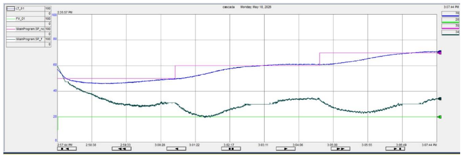
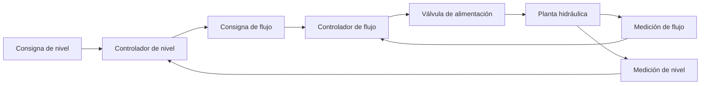

# Control PID de nivel y flujo en una planta de estanque

**Control industrial · PLC ControlLogix · MATLAB/Simulink · Modelación · Control en cascada**

Modelación de una planta hidráulica y comparación de estrategias de control de nivel, flujo y cascada. El proyecto recorre el proceso desde el balance de masa y la identificación de modelos hasta la sintonización y el contraste entre simulación y planta real.

**[Leer informe de control PID](docs/informe-control-pid.pdf) · [Descargar informe PID](docs/informe-control-pid.pdf?raw=true) · [Descargar informe de modelación](docs/informe-modelacion.pdf?raw=true)**

*Ilustración 33 del informe de laboratorio 2, página 56. Registro en planta del seguimiento de nivel y la acción sobre la válvula durante cambios de consigna.*

## Objetivo y contexto

La planta piloto integra un estanque, bomba centrífuga, válvulas de control, sensores de nivel y flujo y un PLC. El reto consiste en regular variables con velocidades muy distintas: el nivel cambia por acumulación de agua, mientras que el flujo responde con mayor rapidez al movimiento de las válvulas.

El trabajo se desarrolla en dos etapas complementarias:

| Etapa | Pregunta principal | Documento |
|---|---|---|
| Modelación | ¿Cómo representar el nivel, la descarga y la respuesta de la válvula? | Laboratorio 1, 41 páginas |
| Control PID | ¿Qué cambia al usar lazos simples o control en cascada? | Laboratorio 2, 60 páginas |

## Modelación de la planta

El balance de volumen del estanque relaciona la variación del nivel con la diferencia entre el caudal de entrada y el de salida. Para un área transversal constante, la estructura del modelo se expresa como `A · dh/dt = q_entrada - q_salida`.

El informe de modelación desarrolla representaciones continuas y discretas, la respuesta de válvulas y modelos de primer orden con retardo. También describe la instrumentación mediante diagramas P&ID, SAMA y de bloques, y procedimientos para estimar ganancia, constante de tiempo y retardo a partir de una respuesta al escalón.

Estos modelos se utilizan como punto de partida para ensayar controladores. La no linealidad de las válvulas, el ruido de medición y las restricciones hidráulicas explican parte de las diferencias posteriores con la planta real.

## Estrategias de control

### Lazos simples

Se estudian controladores PID discretos y sus aproximaciones numéricas, junto con métodos de sintonización en lazo abierto, lazo cerrado y ajuste iterativo. El entorno de trabajo combina MATLAB/Simulink, RSLogix 5000 y la programación del PLC.

Aunque el proyecto se presenta bajo la familia PID, varias sintonías finales documentadas usan tiempo derivativo cero, por lo que operan como controladores PI.

### Control en cascada

El controlador externo de nivel genera la consigna del controlador interno de flujo de alimentación. El lazo de flujo actúa sobre la válvula y responde antes de que una perturbación de alimentación se refleje de forma importante en el nivel del estanque.

*Esquema explicativo elaborado a partir de la descripción del control en cascada del informe.*

## Resultados: simulación frente a planta

Las siguientes cifras reproducen las tablas de desempeño de las páginas 58 y 59 del informe de control PID. Corresponden a las pruebas documentadas; no son especificaciones garantizadas para todo el rango de operación.

| Lazo | Levantamiento, simulación | Levantamiento, planta | Establecimiento, simulación | Establecimiento, planta |
|---|---:|---:|---:|---:|
| Nivel | ≈35,0 s | ≈68,5 s | ≈50,0 s | ≈125,0 s |
| Flujo | ≈0,8 s | ≈2,4 s | ≈1,5 s | ≈4,8 s |
| Cascada | 28,5 s | 52,3 s | 42,0 s | 105,8 s |

| Lazo | Sobrepaso en simulación | Sobrepaso en planta |
|---|---:|---:|
| Nivel | 0 % | 2,5 % |
| Flujo | 0,2 % | 1,8 % |
| Cascada | 1 %, creciente según la tabla | 0,45 % |

La planta responde más lentamente que los modelos simulados. En las pruebas reportadas, la cascada presenta menor sobrepaso y menor tiempo de establecimiento que el lazo de nivel simple. El flujo conserva una dinámica mucho más rápida, condición útil para el lazo interno.

El informe también muestra que la respuesta cambia con el punto de operación y que una sintonía fija pierde desempeño al alejarse de la zona de ajuste. Esta observación motiva el [proyecto de control por programación de ganancias](https://github.com/TheNicolen/Tecnicas-de-control-adaptativo-de-planta-de-un-estanque).

## Qué demuestra el proyecto

- Construcción de modelos a partir de la física del proceso y de respuestas dinámicas.
- Diseño y ajuste de lazos de control en un entorno industrial con PLC.
- Integración maestro-esclavo para control en cascada.
- Comparación de resultados simulados y experimentales, reconociendo ruido, inercias y límites de los actuadores.
- Lectura de tendencias y evaluación de tiempos de respuesta y sobrepaso.

## Alcance de los materiales

Los PDF se publican íntegros, conservando su redacción, tablas, figuras y referencias. Las métricas se presentan como resultados reportados; no se recalcularon porque no se proporcionaron series temporales originales. Las tablas del PDF no indican de forma uniforme las unidades del error estacionario, por lo que esa columna no se reproduce aquí.

Esta entrega incluye documentación y una figura experimental. Los proyectos de PLC, modelos Simulink y datos de ensayo no forman parte de los archivos suministrados para esta publicación.

## Equipo y archivos

**Grupo 10:** Joaquín Cuevas Rodríguez, Nicolás Salas Reyes y Vicente San Martin Pinela. Laboratorio de Sistemas de Control, Universidad de Concepción, 2026-1. Docente indicado en los informes: Juan Pablo Segovia Vera.

Los documentos acreditan trabajo grupal y no especifican una distribución individual de tareas. Este portafolio conserva esa atribución conjunta.

| Archivo | Contenido |
|---|---|
| [Informe de modelación](docs/informe-modelacion.pdf) | Fundamentos físicos, instrumentación y modelos |
| [Informe de control PID](docs/informe-control-pid.pdf) | Controladores, sintonización y pruebas |
| `assets/cascada-planta.png` | Figura experimental extraída del informe 2 |
| `docs/SHA256SUMS.txt` | Huellas de integridad de los PDF originales |

## Otros proyectos

[Control adaptativo y extensión batch](https://github.com/TheNicolen/Tecnicas-de-control-adaptativo-de-planta-de-un-estanque) · [Procesador RISC-V](https://github.com/TheNicolen/Dise-o-de-procesador-RISCV-multiciclo) · [Procesamiento de imágenes en FPGA](https://github.com/TheNicolen/SuperResolucionMedianteInterpolacionBicubicayVecinomasCercanoenunaRegionArbitraria)
